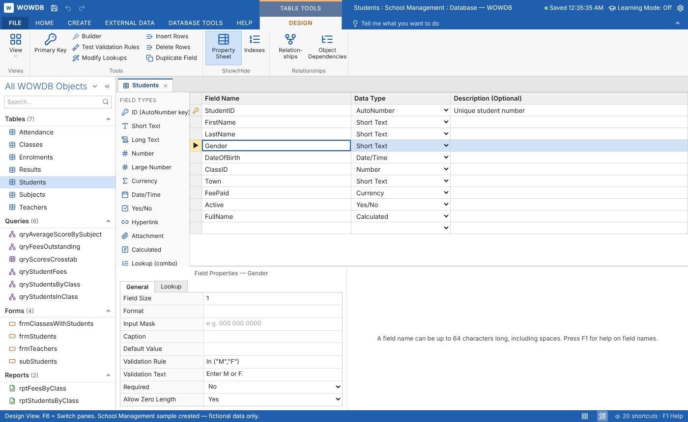
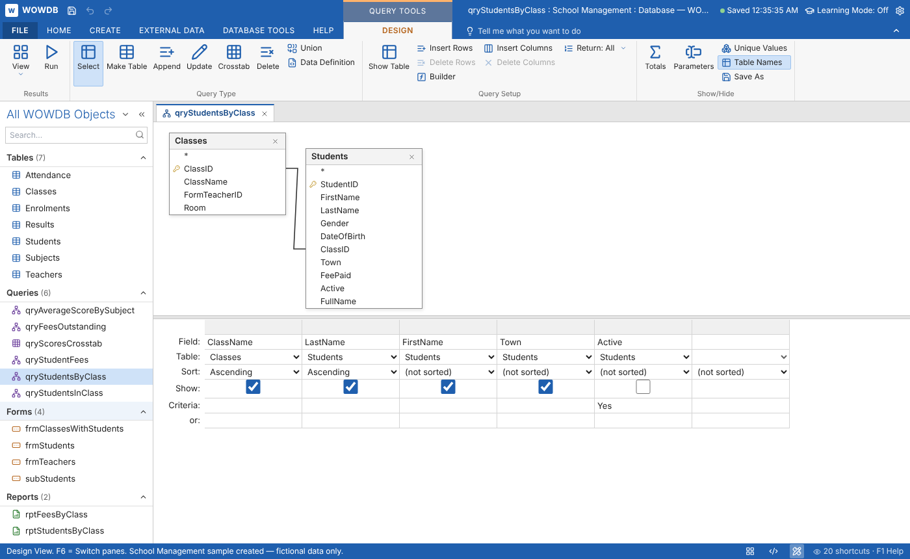
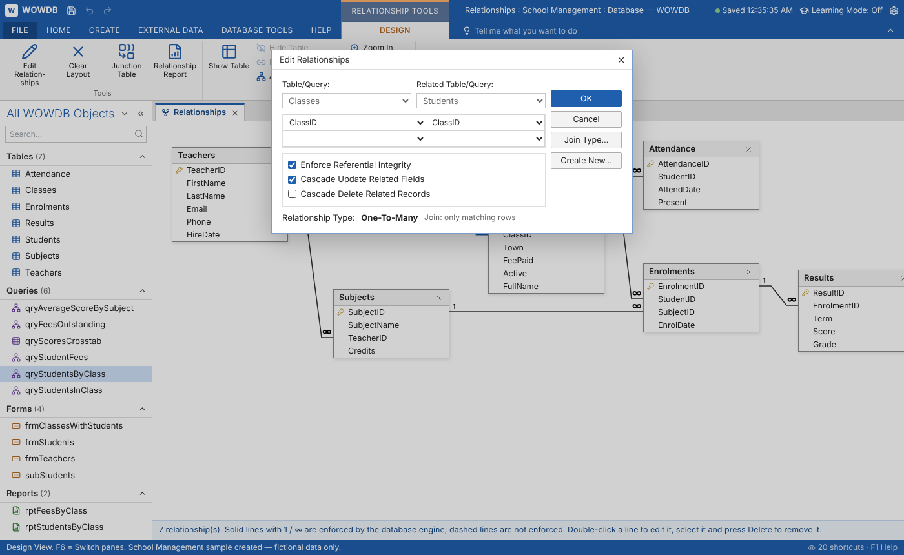
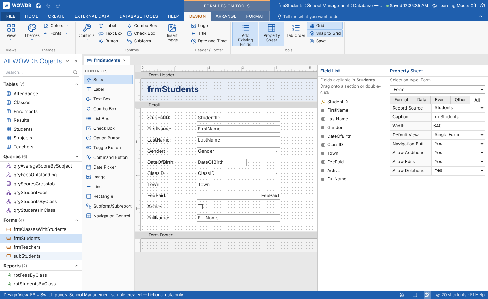
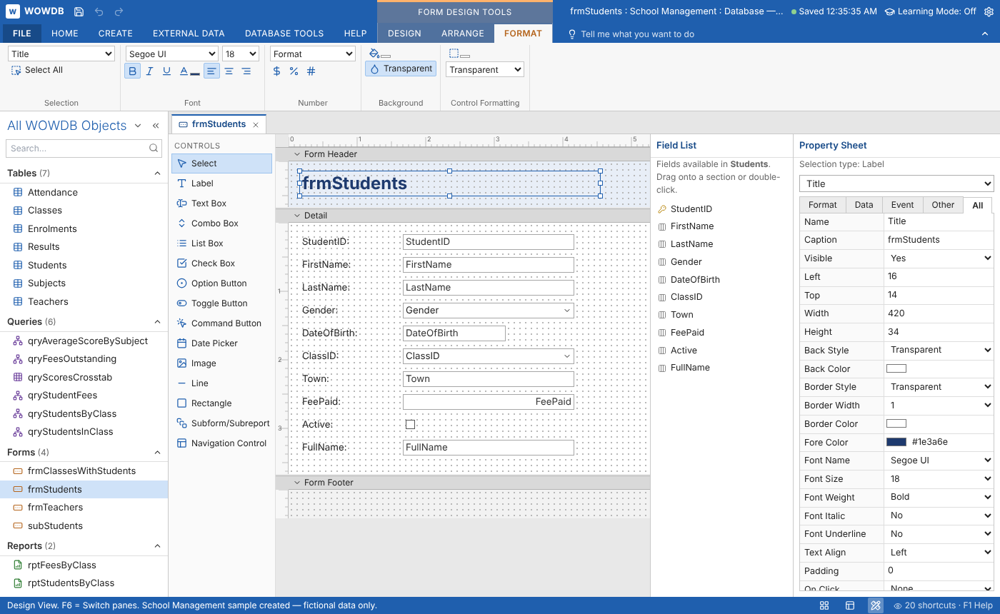
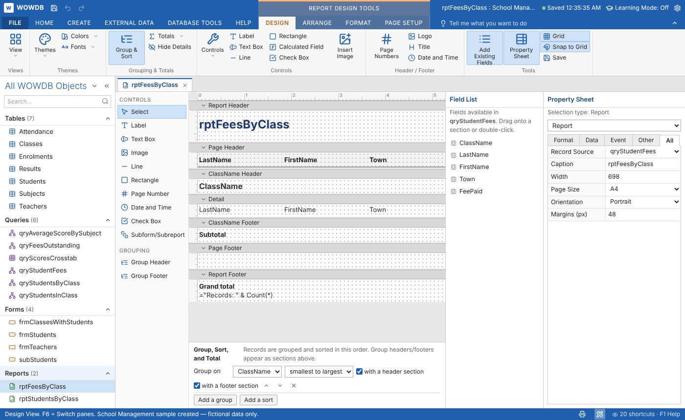
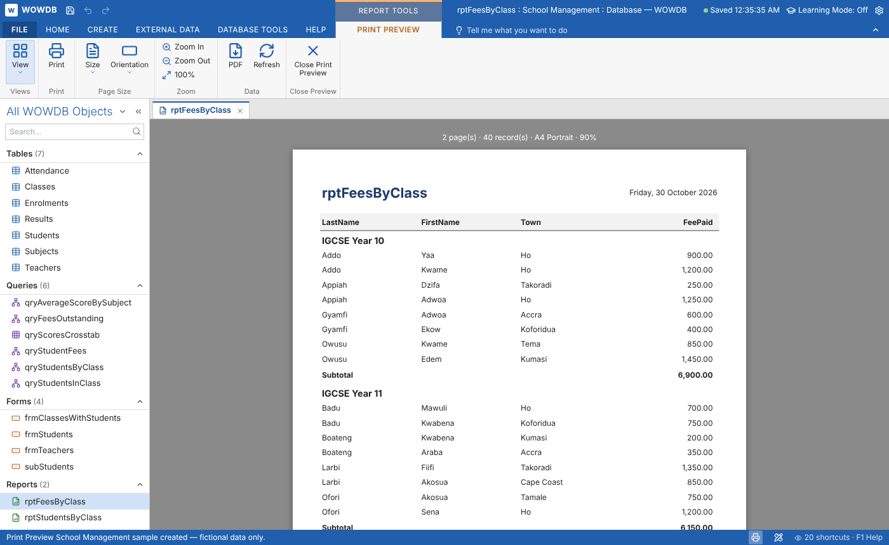

# WOWDB

WOWDB is an educational database development environment inspired by the Microsoft Access desktop application. It is built for classroom demonstrations, practical lessons, database training and independent student projects.

WOWDB is not a mock-up. Every table, relationship, query, form and report works against a real relational engine: SQLite 3.45, compiled to WebAssembly (sql.js) and running inside the browser. Each database is one SQLite file that also stores the WOWDB object definitions, so a `.wowdb` file can be opened by any SQLite tool.

WOWDB is an original, non-commercial educational project. It is not affiliated with or endorsed by Microsoft. "Microsoft Access" is a trademark of Microsoft Corporation.

## What a student can do

1. Create a database (blank, or from one of five fictional sample databases).
2. Design tables in Design View: field names, data types, field properties, validation rules, indexes, lookups and primary keys (including composite keys), with drag-and-drop field ordering and a field toolbox.
3. Enter, edit, sort, filter, search, copy and paste records in Datasheet View.
4. Create relationships by dragging a primary key onto a foreign key, with enforced referential integrity, cascade update and cascade delete. These become real SQLite FOREIGN KEY constraints.
5. Build queries by dragging tables and fields (select, parameter, totals, crosstab, make-table, append, update and delete), or write SQL in SQL View. Simple SQL is translated back into Design View; anything that cannot be represented exactly is kept as SQL.
6. Design forms by dragging controls onto Form Header, Detail and Form Footer sections, with a Property Sheet, alignment tools, grid snapping, grouping, tab order, subforms, combo boxes and command buttons. Use them in Form View to add, edit and delete records.
7. Design reports with report, page, group and detail sections, grouping, sorting and totals; preview, print and export to PDF.
8. Import CSV, Excel, JSON and SQL through a 10-step import wizard; export CSV, Excel, JSON, SQL and PDF.
9. Save, close and reopen: everything is saved automatically in the browser and can be downloaded as a `.wowdb` file.
10. Learn with the Learning Centre: 20 topics with knowledge checks, guided practicals and sample-database exercises that are checked automatically against the real database.

## Screens

The interface follows the familiar desktop database layout: ribbon with contextual tool tabs (TABLE TOOLS, QUERY TOOLS, RELATIONSHIP TOOLS, FORM DESIGN TOOLS, REPORT DESIGN TOOLS), Navigation Pane, tabbed documents and a status bar. These screenshots are produced from the running app by `tests/e2e/screens.cjs`, so they always match the current build.

| | |
|---|---|
| Table Design View with Field Properties |  |
| Query Design View (table workspace and Field / Table / Sort / Show / Criteria grid) |  |
| Relationships window with Edit Relationships |  |
| Form Design View (Form Header, Detail, Form Footer, rulers, Field List, Property Sheet) |  |
| Form Design Tools: Format tab |  |
| Report Design View (Report Header, Page Header, group sections, Detail, Page Footer, Report Footer) |  |
| Print Preview |  |

To refresh them: `npm run build:portable && node tests/e2e/screens.cjs docs/screenshots`.

## Three ways to run it

| Delivery | How |
|---|---|
| Hosted browser app | Open the published page. Nothing to install. |
| Portable single file | `dist-portable/index.html` is one self-contained file (about 2.8 MB, SQLite included). Copy it to a USB stick or classroom PC and double-click it. |
| Next.js project | `npm install`, then `npm run dev` (development) or `npm run build` (static export to `out/`). |

## Getting started (developers)

Requirements: Node.js 20 or newer.

```bash
npm install            # also copies sql-wasm.wasm into public/
npm run dev            # http://localhost:3000
npm run build          # static export in out/
npm run build:portable # single-file build in dist-portable/index.html
npm test               # engine tests (Vitest, real SQLite)
npm run test:e2e       # browser acceptance + feature tests (Playwright)
npm run typecheck      # strict TypeScript
```

## Project layout

```
app/                  Next.js entry (layout, page, global styles)
portable/             Entry HTML for the single-file build
src/engine/           Database engine layer (no UI code)
  sqlite.ts           sql.js wrapper; every data operation goes through here
  project.ts          catalogue, schema builder, table rebuilds, relationships, records, error messages
  expr.ts             Access expression language: parser, SQL translator, evaluator, formats
  queries.ts          Query Design ⇄ SQL, execution of all query types
  report.ts           report grouping, pagination, expressions and PDF output
  objects.ts          form/report model, control defaults, property schema, wizards
  interchange.ts      CSV / XLSX / JSON / SQL import and export
  utilities.ts        documenter, dependencies, integrity, performance, statistics, compact
  persistence.ts      IndexedDB storage, backups, downloads
  samples.ts          five sample databases (fictional data)
src/learning/         Learning Mode content and automatic checks
src/ui/               React interface (shell, ribbon, designers, dialogs)
tests/                Vitest engine tests and Playwright browser tests
```

See ARCHITECTURE.md, FEATURE_STATUS.md, TESTING.md and DEVELOPMENT_LOG.md.

## Data and privacy

All sample data is fictional. Databases are stored only in the browser that created them (IndexedDB) unless the user downloads or exports them. No data is sent to a server.
